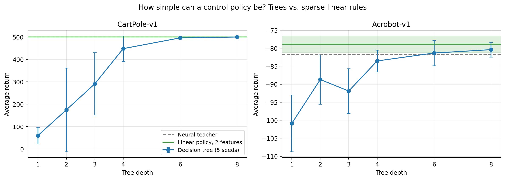

# How Simple Can a Control Policy Be?
### Distilling neural RL policies into decision trees and sparse linear rules

Interpretable robot policies let people inspect, verify, and trust what a learned controller does.
But "simple" can mean different things: a shallow decision tree, or a linear rule over a few
features. This mini-study asks: **how much simplicity can control tasks tolerate, does the best
form of simplicity depend on the task, and are simple policies' explanations stable across
training runs?**

## Setup
- **Tasks:** CartPole-v1 (balance a pole on a cart) and Acrobot-v1 (swing up a two-link arm), via Gymnasium.
- **Teachers:** PPO neural-network policies (Stable-Baselines3). CartPole: 500.0 ± 0.0 (the maximum);
  Acrobot: −81.8 ± 1.4 (100 episodes, standard error).
- **Students:** trained by DAgger (8 rounds, 10 episodes each), with the teacher labeling every state
  the student visits:
  - decision trees of depth 1, 2, 3, 4, 6, and 8
  - L1-regularized linear (logistic) policies at four sparsity levels
  - linear policies restricted to every pair of features
- **Evaluation:** 20 new episodes per student (100 for the final teacher comparison), 5 random seeds each.

*Tree error bars show the spread across 5 seeds. The green band shows ±1 standard error of the
2-feature linear policy over 100 new episodes. On CartPole, the teacher's line (500) is hidden
under the linear policy's line.*

## Results
**1. On CartPole, trees need depth 8, but a 2-weight linear rule is perfect.** Tree returns rose from
60 (depth 1) to 448 (depth 4) and reached 500 only at depth 8. A linear policy using only **pole angle
and pole angular velocity** scored 500 ± 0 for every seed; every other feature pair failed (46–322).

**2. The tree failed because of its form, not its information.** A depth-2 tree splitting on exactly
those two features scored 47: its root split on angular velocity, but both branches then applied the
same rule on pole angle, so it effectively ignored angular velocity. Axis-aligned trees cannot express
"angle plus a multiple of angular velocity," which is what the task needs.

**3. On Acrobot, even tiny trees work, and two model types agree.** A single split reached −101 and
depth 4 matched the teacher (−83.5). Trees split first on link-1 velocity and then on link-2 velocity,
and the sparsest linear policy selected exactly those two features. A 2-feature linear policy matched
the teacher on 100 new episodes (−78.9 ± 2.3 vs. −81.8 ± 1.4). An apparent advantage over the teacher
in a 20-episode evaluation was not confirmed.

**4. Simple policies' explanations are only trustworthy when they are stable.** On Acrobot, depth-2
trees from five seeds agreed on 99% of actions and all used the same root feature. On CartPole they
agreed on only 61%, used different root features, and scored anywhere from 47 to 498. When no simple
rule of the right form exists, small trees land on different, unequal explanations.

**Takeaway:** the right *form* of simplicity is task-dependent. Trees suit Acrobot's switching logic;
CartPole needs a linear combination that trees can only approximate with many splits. This motivates
interpretable policy classes that combine both, such as trees with simple linear controllers.

## Limitations
- Two low-dimensional classic-control tasks; real robots have richer observations and continuous actions.
- Students imitate one teacher; they do not learn from rewards directly.
- 5 seeds and 20 evaluation episodes per student; differences of a few return points are within noise.
- Standard CART trees and L1 logistic regression only; no oblique or differentiable trees.

## Reproducing
Open `interpretable_control_policies.ipynb` in Google Colab (`pip install stable-baselines3 gymnasium`).
Training both teachers takes about 7 minutes on CPU.
